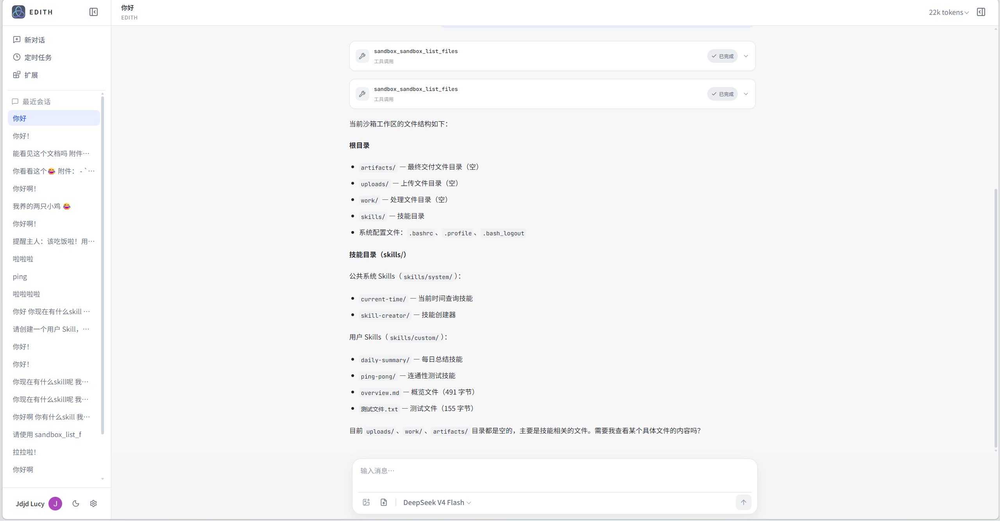
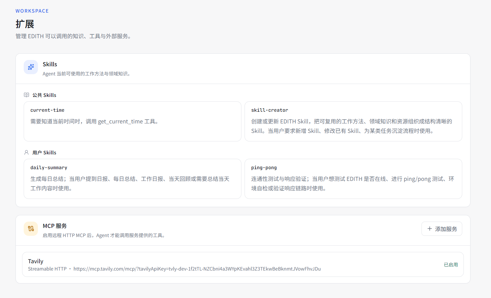
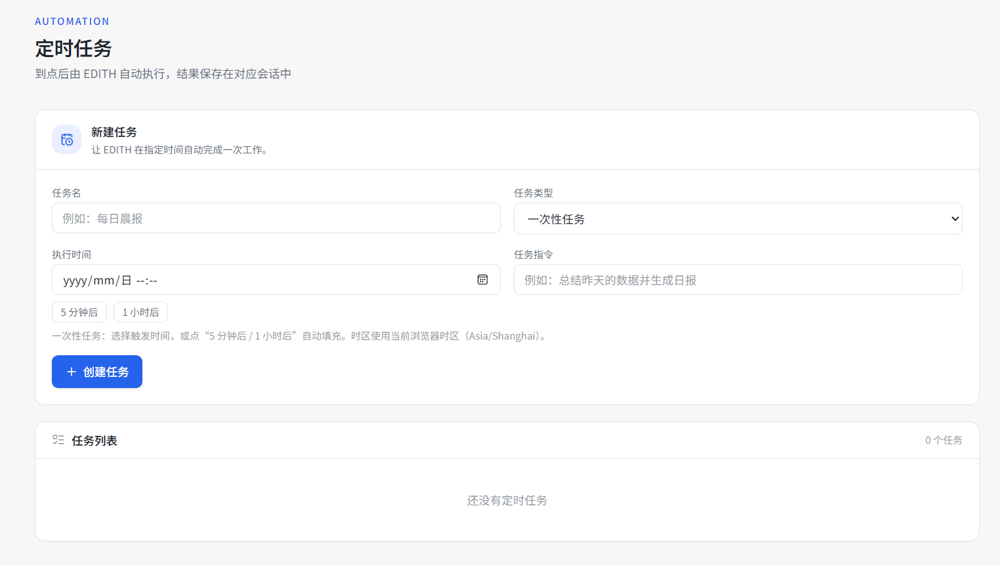
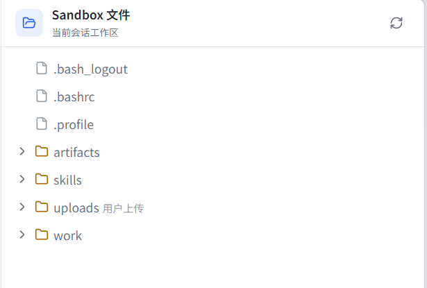
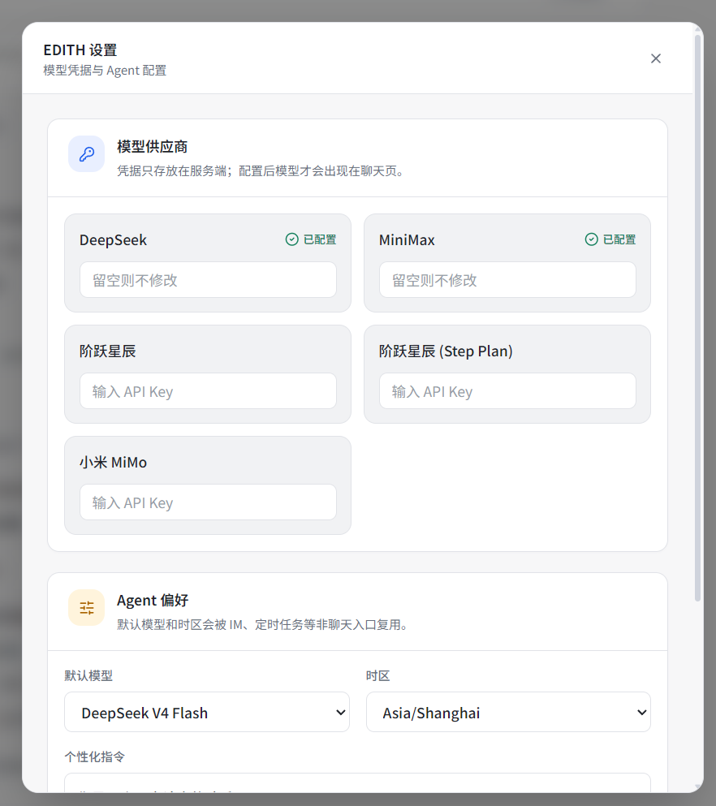

# EDITH

[中文](README.zh-CN.md) · An extensible, multi-user server-side AI Agent platform.

EDITH is not a single chat page. It is a long-running **multi-user server-side Agent platform**: every user gets isolated identity, configuration, sessions, sandboxes and workspaces, and can chat with models, let the Agent read and write real files, build reusable Skills, connect MCP services, push code to Git, and schedule recurring tasks.

> Backend: [`backend-py/`](backend-py/) — Python 3.13 + FastAPI. `web-v1/` consumes the same HTTP/SSE contract as before; the earlier Go implementation is kept in [`backend-v2/`](backend-v2/) for reference and comparison.

Live demo: <https://surpag.de5.net/>

> Web is the first user channel. IM channels are intentionally left for a future phase — the Gateway boundary already exists for them.

## What makes EDITH different

- **A real Agent runtime, not a wrapper** — a single `Gateway` normalizes every channel into one request, `AgentRun` assembles the run (model, keys, personality, Skills, workspace memory, images, tools), and a **hand-written Function-Calling loop** drives streaming, tool dispatch and result feedback. No agent framework sits in between: every token, tool call and cancellation point stays under our control.
- **Multi-user by construction** — Clerk identity scopes requests, sessions, configuration, sandboxes, volumes and scheduled jobs. Users never share a runtime or a credential, and tools validate *authorization* (may this session touch this workspace?) rather than path format alone.
- **A workspace with exactly one authority** — a workspace maps to a real project directory. Storage sits behind one switch (`e2b` volume or `local`), so the Agent always reads and writes the authoritative copy instead of racing a mirror.
- **Deletes stay deleted** — a persisted consensus file set drives both sync directions with a single set difference, so a delete on one side can never be resurrected by the other.
- **Failures degrade instead of ending the conversation** — sandbox failure becomes a tool error the model can react to, model calls fall back through request → user default → platform default, image reads degrade to text-only input. Every fallback is explicitly marked in the terminal event.
- **Cost is measurable** — real streaming usage (including cached tokens) is captured per run, with explicit "unknown" versus "zero cache hit" semantics and a coverage indicator on aggregates.
- **Skills load progressively** — only summaries enter the context; the body is read on demand, so the catalog can grow without eating the token budget.
- **Everything is traceable** — a `request_id` runs from the HTTP boundary through execution to each tool call, per-step timings are written as JSONL, and a CLI (`edith-trace`) lists, shows and ranks slow runs.

## Screenshots











## Features

### Agent conversations

- Streaming text, reasoning and tool-call cards over SSE
- Multi-provider models: a read-only built-in catalog plus user-defined providers and models, added from the UI without a redeploy
- Image input backed by Tencent COS, with history hydration
- Rolling session summaries at ~40% of the active model's context window; clipping retry when the summary request itself overflows, and full-history fallback when summarization fails
- Run status and cancellation by `request_id`; client disconnect cancels the run and releases its resources instead of leaving it hanging
- Resume after interruption: task status plus tool-call checkpoints let the next run continue rather than restart

### Workspace and sandbox

- One E2B sandbox per `user_id + session_id`, exposing file, directory and process tools
- Workspace binding to a project directory, with per-workspace instructions, memory and allowed egress domains
- Pluggable storage backend; bidirectional sync with size-first comparison, per-file size cap, binary exclusion, failure circuit breaker and explicit request timeouts
- File panel in the chat page; uploads to `/uploads`, deliverables in `/artifacts`
- Egress allow-list enforced by the sandbox network policy

### Skills, MCP and Git

- Built-in Skills shipped with the server and mounted into every sandbox; user Skills stored in the user's volume
- `overview.md` gives both the Agent context and the Extensions page a stable, cheap summary
- Remote MCP servers over **streamable HTTP** and **SSE**, configured and toggled in the UI; connection lifetime is bound to the run that opened it
- Push a workspace to a Git remote: the sandbox only produces a bundle, the backend injects the token from the environment and pushes — credentials never enter the sandbox or a command line

### Scheduled tasks

- One-time and recurring cron jobs, per-user timezone and default model
- Atomic SQL claiming, so a job never runs twice under concurrency or multiple instances
- Every execution goes through the same Gateway and lands in its own conversation session

## Architecture at a glance

Channels, execution and infrastructure are kept apart; the main path is deliberately short:

```text
Browser ──► Next.js BFF ──► WebAdapter ┐
                                       ├──► Gateway ──► AgentRun ──► Function-Calling loop
Cron scheduler ──► CronAdapter ────────┘    identity      config            │
                                                                             ▼
                                                          neutral Agent events (SSE)
```

The backend is organized as explicit modules. Each module owns its storage, its HTTP boundary when it has one, and its public capability; `main.py` only creates modules and connects them.

```text
backend-py/src/edith_backend/
├─ main.py             composition root, middleware, route wiring
├─ config.py           environment loading
├─ database.py         SQLite connection + WAL
└─ internal/
   ├─ agentrun/        admission → configuration → streaming execution
   ├─ agentstream/     channel-neutral event model and stream decoder
   ├─ gateway/         identity and request boundary for all channels
   ├─ webadapter/      Web BFF HTTP / SSE adapter
   ├─ cronadapter/     scheduled run → Gateway message
   ├─ conversation/    history projected into the browser timeline
   ├─ session/         messages, task status, checkpoints, usage rows
   ├─ models/          built-in catalog + user-defined models
   ├─ userconfig/      settings, provider keys, MCP servers, bindings
   ├─ sandbox/         E2B lifecycle, file/command tools, file HTTP
   ├─ workspace/       workspace entity, storage backends, sync
   ├─ volume/          per-user persistent volume
   ├─ skills/          built-in and user Skill catalog
   ├─ images/          image metadata and COS access
   ├─ gitops/          guarded Git execution and credential injection
   ├─ cronjob/         job storage, scheduler and Agent tools
   ├─ usage/           token accounting and aggregation
   ├─ trace/           per-run spans, JSONL storage, CLI viewer
   ├─ systemtools/     tools that need no user data
   ├─ tools.py         tool registry
   └─ netguard.py      shared SSRF / egress validation
```

Two rules hold the design together:

- **One authoritative implementation per capability** — storage backends, the model catalog and the push entry point are each a single class, not conditional branches spread across files.
- **Diagnostics never drive control flow** — terminal reasons and trace spans feed logs and UI only; whether a run resumes depends on task status and checkpoints, nothing else.

## Reliability and safety

| Concern | Approach |
| --- | --- |
| Sandbox outage | Sandbox errors become tool results; the Agent answers in plain text instead of failing the turn |
| Model outage | Bounded retries for retryable errors, then request → user default → platform default fallback, marked in the terminal event |
| Deletion | Consensus-set propagation with five guard rails (no baseline, rebuilt sandbox, per-round cap, whole-workspace disappearance, kill switch) |
| Path escape | One authorization checkpoint validates every path-taking tool, including multi-field tools such as move |
| SSRF | Private/loopback ranges rejected; cloud metadata endpoints rejected unconditionally |
| Git credentials | Injected by the backend via environment variables; never written to disk, argv or the sandbox |
| Provider secrets | Stored obfuscated with a version prefix; treated explicitly as obfuscation, not encryption |

## Technology

- **Backend**: Python 3.13, FastAPI, uvicorn, asyncio, Pydantic v2, OpenAI SDK (orchestration written by hand)
- **Storage**: SQLite via `aiosqlite` (WAL, online backup, migrations)
- **Sandbox**: E2B sandboxes and volumes; Tencent COS for images
- **Frontend**: Next.js 16, React, TypeScript, Tailwind CSS
- **Identity**: Clerk
- **Deployment**: Docker Compose, Nginx (SSE-aware), Cloudflare Tunnel
- **Quality**: `pytest` (220+ cases, including migrations, sync delete propagation and usage accounting), `ruff`

## Run locally

1. Copy the environment template and fill in Clerk, model provider, E2B and COS values:

   ```bash
   cp .env.example .env
   ```

2. Start the backend:

   ```bash
   cd backend-py
   uv sync
   uv run uvicorn edith_backend.main:app --reload --host 127.0.0.1 --port 8080
   ```

   Using a virtualenv instead of `uv`:

   ```bash
   cd backend-py
   python -m venv .venv
   ./.venv/Scripts/python.exe -m pip install -e .
   ./.venv/Scripts/python.exe -m uvicorn edith_backend.main:app --reload --host 127.0.0.1 --port 8080
   ```

3. Start the web app in another terminal:

   ```bash
   cd web-v1
   npm install
   npm run dev
   ```

4. Open `http://localhost:3000`.

Or run the whole stack with Docker (reads the root `.env`):

```bash
docker compose up -d --build
```

## Repository guide

| Path | Purpose |
| --- | --- |
| `backend-py/` | Current backend — Python 3.13 + FastAPI |
| `web-v1/` | Next.js web client and BFF |
| `deploy/` | Deployment, TLS, tunnel and backup runbooks |
| `e2b-template/` | E2B sandbox template |
| `docs/` | Architecture, protocol, design and post-mortem notes |
| `backend-v2/` | Earlier Go implementation, kept for reference |
| `edith-studio/` | Local desktop coding-agent client |

## Documentation

- [`docs/project-walkthrough.md`](docs/project-walkthrough.md) — end-to-end walkthrough of the whole system (Chinese)
- [`docs/cloud-multitenant-migration.md`](docs/cloud-multitenant-migration.md) — multi-tenant migration and workspace storage model (Chinese)
- [`docs/observability.md`](docs/observability.md) — trace shape and how to debug with it (Chinese)
- [`deploy/README.md`](deploy/README.md) — deploy, HTTPS, tunnel, backup and restore (Chinese)

## Status

The core platform is complete and running in production: conversations, tool loop, sandboxes, workspaces with sync, Skills, MCP, Git push, scheduled tasks, per-user configuration and context compression work together. Adding a new channel means writing an adapter against the Gateway contract — the execution core does not change.
