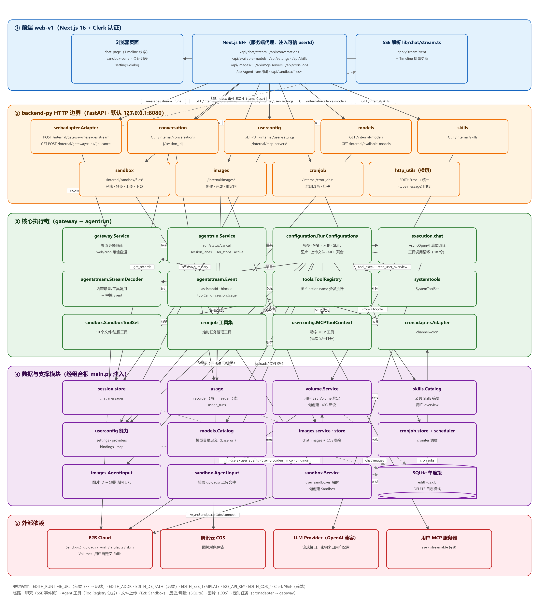

# EDITH 前后端系统结构原理图（web-v1 前端 + backend-py 后端）

> 覆盖范围：`web-v1`（Next.js 前端与 BFF）→ `backend-py`（FastAPI，16 个内部模块）→ SQLite / E2B / 腾讯云 COS / LLM / MCP 等外部依赖。
> 对应 Go 版：`backend-v2`（backend-py 是其 1:1 重构）。
> 已渲染图片：[PNG](assets/系统结构原理图.png) / [SVG（矢量）](assets/系统结构原理图.svg)；下方为可编辑的 Mermaid 源码（VS Code + Mermaid 插件、Typora、GitHub、[mermaid.live](https://mermaid.live) 均可渲染）。

```mermaid
flowchart TB
    classDef fe fill:#E3F2FD,stroke:#1565C0,color:#0D2B52,stroke-width:2px
    classDef be fill:#FFF3E0,stroke:#EF6C00,color:#5C2E00,stroke-width:2px
    classDef core fill:#E8F5E9,stroke:#2E7D32,color:#143B18,stroke-width:2px
    classDef data fill:#F3E5F5,stroke:#7B1FA2,color:#3A0B4E,stroke-width:2px
    classDef db fill:#EDE7F6,stroke:#4527A0,color:#22115E,stroke-width:2px
    classDef ext fill:#FFEBEE,stroke:#C62828,color:#5C1010,stroke-width:2px

    subgraph FE["① 前端 web-v1（Next.js 16 + Clerk 认证）"]
        direction TB
        BR["浏览器页面<br/>chat-page（Timeline 状态）· sandbox-panel<br/>conversation-list · settings-dialog"]
        BFF["Next.js BFF（服务端代理，注入可信 userId）<br/>/api/chat/stream · /api/conversations<br/>/api/available-models · /api/settings · /api/skills<br/>/api/images/* · /api/mcp-servers · /api/cron-jobs<br/>/api/agent-runs/[id] · /api/sandbox/files/*"]
        SSE["SSE 解析 lib/chat/stream.ts<br/>applyStreamEvent → Timeline 增量更新"]
    end

    subgraph HTTP["② backend-py HTTP 边界（FastAPI，默认 127.0.0.1:8080）"]
        direction TB
        WA["webadapter.Adapter<br/>POST /internal/gateway/messages:stream<br/>GET·POST /internal/gateway/runs/[id]·cancel"]
        CV["conversation<br/>GET /internal/conversations[/session_id]"]
        UC["userconfig<br/>GET·PUT /internal/user-settings<br/>/internal/mcp-servers*"]
        MD["models<br/>GET /internal/models · available-models"]
        SK["skills<br/>GET /internal/skills"]
        SB["sandbox<br/>/internal/sandbox/files*（列表/预览/上传/下载）"]
        IMG["images<br/>/internal/images*（创建/完成/重定向）"]
        CJ["cronjob<br/>/internal/cron-jobs*"]
        EU["http_utils（横切）<br/>EDITHError → 统一 {type,message}"]
    end

    subgraph CORE["③ 核心执行链（gateway → agentrun）"]
        direction TB
        GW["gateway.Service<br/>渠道身份翻译（web/cron 可信直通）"]
        AR["agentrun.Service<br/>run/status/cancel · session_lanes 会话门闩<br/>user_stops · active 任务表"]
        CONF["configuration.RunConfigurations.load<br/>聚合：模型定义·API Key·人格·Skills<br/>图片·上传文件·MCP 工具"]
        EXEC["execution.chat<br/>AsyncOpenAI 流式循环 + 工具调用循环（≤8 轮）"]
        DEC["agentstream.StreamDecoder<br/>内容增量/工具调用 → 中性 Event"]
        EV["agentstream.Event<br/>assistantId · blockId · toolCallId · sessionUsage"]
        TR["tools.ToolRegistry<br/>按 function.name 分发执行"]
        STS["systemtools.SystemToolSet"]
        SSTS["sandbox.SandboxToolSet（10 个工具）"]
        CJTS["cronjob 工具集"]
        MCPC["userconfig.MCPToolContext（动态 MCP 工具）"]
        CAD["cronadapter.Adapter<br/>channel=cron"]
    end

    subgraph DATA["④ 数据与支撑模块（经组合根注入）"]
        direction TB
        DB[("SQLite 单连接<br/>edith-v2.db（DELETE 日志模式）")]
        SESS["session.store<br/>chat_messages"]
        USAGE["usage<br/>recorder（写）· reader（读）<br/>usage_runs"]
        VOL["volume.Service<br/>用户 E2B Volume 绑定<br/>懒创建 · 403 降级"]
        SKC["skills.Catalog<br/>公共 Skills 摘要 + 用户 overview"]
        UCAPI["userconfig 能力<br/>settings · providers · bindings · mcp"]
        MDC["models.Catalog<br/>模型目录定义（base_url 等）"]
        IMGC["images.service · store<br/>chat_images + COS 签名 URL"]
        CJST["cronjob.store + scheduler"]
        IMGAI["images.AgentInput<br/>图片 ID → 短期访问 URL"]
        SBAI["sandbox.AgentInput<br/>校验 uploads/ 上传文件"]
        SBVC["sandbox.Service<br/>user_sandboxes 映射 · 懒创建 Sandbox"]
    end

    subgraph EXT["⑤ 外部依赖"]
        direction TB
        E2B["E2B Cloud<br/>Sandbox：uploads / work / artifacts / skills<br/>Volume：用户自定义 Skills"]
        COS["腾讯云 COS"]
        LLM["LLM Provider（OpenAI 兼容）<br/>流式接口，密钥来自用户配置"]
        MCPSRV["用户 MCP 服务器<br/>sse / streamable 传输"]
    end

    BR -->|"fetch 请求"| BFF
    BFF -->|"POST /internal/gateway/messages:stream"| WA
    BFF -->|"GET /internal/agent-runs/[id]"| WA
    BFF -->|"GET /internal/conversations..."| CV
    BFF -->|"GET·PUT /internal/user-settings"| UC
    BFF -->|"GET /internal/available-models"| MD
    BFF -->|"GET /internal/skills"| SK
    BFF -->|"POST /internal/sandbox/files/upload"| SB
    BFF -->|"POST /internal/images..."| IMG
    BFF -->|"GET·POST /internal/cron-jobs"| CJ

    WA -->|"IncomingMessage channel=web"| GW
    GW -->|"to_agentrun_request"| AR
    AR -->|"配置聚合"| CONF
    AR -->|"启动流式执行"| EXEC
    EXEC -->|"流式 chat completions"| LLM
    EXEC -->|"tool_executor.execute"| TR
    TR -->|"按名分发"| STS
    TR -->|"按名分发"| SSTS
    TR -->|"按名分发"| CJTS
    TR -->|"MCP 优先"| MCPC
    EXEC -->|"增量"| DEC
    DEC -->|"Event"| EV
    WA -.->|"SSE：data: 事件 JSON（camelCase）"| SSE
    SSE -->|"更新 Timeline"| BR

    SSTS -->|"AsyncSandbox 文件/命令 API"| E2B
    SB -->|"workspace() 懒创建"| SBVC
    SBVC -->|"AsyncSandbox.create/connect"| E2B
    SBVC -->|"mount_for_user"| VOL
    VOL -->|"AsyncVolume（挂载/overview）"| E2B
    SK -->|"read_user_overview"| VOL
    SKC -->|"读 overview.md"| VOL
    MCPC -->|"连接与调用"| MCPSRV
    IMG -->|"COS 预签名 URL（PUT 直传 / GET 预览）"| COS

    CV -->|"get_records"| SESS
    CV -->|"session_summary"| USAGE
    AR -->|"add_user_message / add_assistant_message"| SESS
    AR -->|"usage.start / finish / fail"| USAGE
    CONF -->|"模型定义"| MDC
    CONF -->|"密钥 · 人格 · 默认模型"| UCAPI
    CONF -->|"图片 → 短期 URL"| IMGAI
    CONF -->|"uploads/ 文件校验"| SBAI
    CONF -->|"Skills 摘要"| SKC
    CONF -->|"MCP 工具定义"| MCPC
    MD -->|"providers.list_statuses"| UCAPI
    UC -->|"settings / providers / mcp"| UCAPI
    IMG -->|"落库"| IMGC

    SESS -.->|"chat_messages"| DB
    USAGE -.->|"usage_runs"| DB
    VOL -.->|"user_volumes"| DB
    SBVC -.->|"user_sandboxes"| DB
    UCAPI -.->|"users · user_agents · user_providers<br/>user_mcp_servers · user_mcp_headers · user_channel_bindings"| DB
    CJST -.->|"cron_jobs"| DB
    IMGC -.->|"chat_images"| DB

    CJ -->|"store / toggle"| CJST
    CJST -->|"scheduler 触发（croniter）"| CAD
    CAD -->|"gateway.run（channel=cron）"| GW

    class BR,BFF,SSE fe
    class WA,CV,UC,MD,SK,SB,IMG,CJ,EU be
    class GW,AR,CONF,EXEC,DEC,EV,TR,STS,SSTS,CJTS,MCPC,CAD core
    class SESS,USAGE,VOL,SKC,UCAPI,MDC,IMGC,CJST,IMGAI,SBAI,SBVC data
    class DB db
    class E2B,COS,LLM,MCPSRV ext
```

## 关键链路说明

| # | 链路 | 路径 |
| --- | --- | --- |
| 1 | **聊天（主链路）** | 浏览器 → BFF `/api/chat/stream` → `webadapter` → `gateway` → `agentrun` → `execution.chat` 流式调用 LLM；增量经 `StreamDecoder` 转 `Event`，由 `webadapter` 以 SSE（camelCase JSON）流回 → BFF 透传 → 前端 `applyStreamEvent` 增量更新 Timeline |
| 2 | **Agent 工具调用** | `execution.chat` → `ToolRegistry.execute` → 按名分发到 `SystemToolSet` / `SandboxToolSet` / cron 工具集 / MCP 工具（MCP 优先）；沙箱工具最终落到 E2B Sandbox 的文件/命令 API |
| 3 | **文件上传** | 浏览器 → BFF `/api/sandbox/files/upload` → `sandbox` HTTP → `sandbox.Service.workspace()`（首次懒创建 E2B Sandbox 并写 `user_sandboxes`）→ 写入沙箱 `uploads/{name}`；创建时经 `volume.mount_for_user` 挂载用户 Volume（未启用 Volumes 时降级为无卷） |
| 4 | **会话历史与用量** | 浏览器 → BFF `/api/conversations/{id}` → `conversation` → `session.store`（`chat_messages` 投影 Timeline）+ `usage.reader`（`usage_runs` 汇总） |
| 5 | **图片** | 浏览器 → BFF `/api/images/*` → `images` → 腾讯云 COS 预签名 URL（浏览器直传/预览），记录存 `chat_images`；Agent 运行中经 `images.AgentInput` 转短期访问 URL |
| 6 | **定时任务** | BFF `/api/cron-jobs*` 管理（`cronjob` HTTP + store）；`cronjob.scheduler`（croniter）到点经 `cronadapter`（channel=cron）→ `gateway.run` → 与聊天同一执行链 |
| 7 | **配置/模型/技能/MCP** | `userconfig`（设置、供应商密钥、渠道绑定、MCP 服务）与 `models`（目录）供前端管理与 agentrun 配置聚合；`skills` 读 `volume` 的 overview 展示公共/自定义技能 |

## 关键配置与环境变量

| 变量 | 默认值 | 作用 |
| --- | --- | --- |
| `EDITH_RUNTIME_URL`（web-v1） | `http://127.0.0.1:8080` | 前端 BFF 代理到的后端地址 |
| `EDITH_ADDR`（backend-py） | `127.0.0.1:8080` | 后端监听地址 |
| `EDITH_DB_PATH` | `edith-v2.db` | SQLite 文件路径（单连接） |
| `EDITH_E2B_TEMPLATE` | `default`（`main.py` 兜底） | E2B Sandbox 模板名（注意：`config.sandbox_template()` 的必填校验当前未被 main.py 调用） |
| `E2B_API_KEY` | — | E2B 凭据（Sandbox + Volume） |
| `EDITH_COS_BUCKET / REGION / SECRET_ID / SECRET_KEY` | `""` | 腾讯云 COS（图片存储） |
| `NEXT_PUBLIC_CLERK_*`、`CLERK_SECRET_KEY` | — | 前端 Clerk 认证（web-v1） |
| `EDITH_E2B_DEBUG_HTTP` | 未设置 | `true` 时开启 volume 模块诊断日志 |
